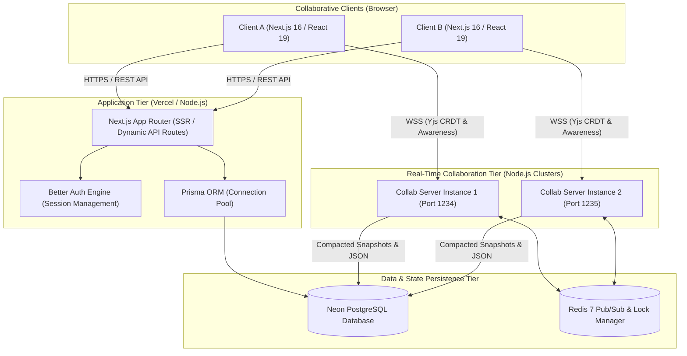
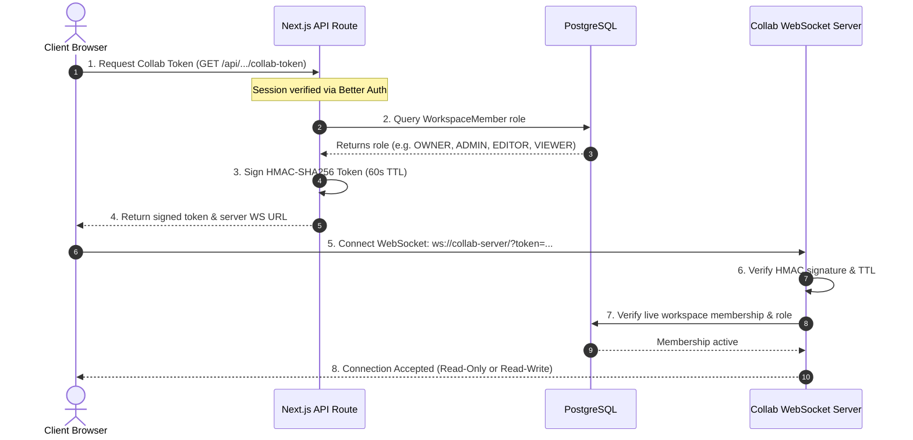
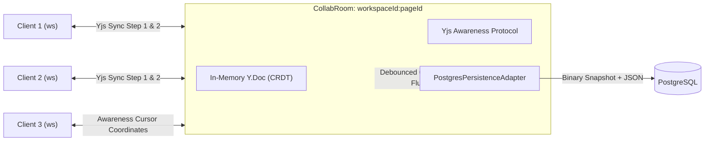
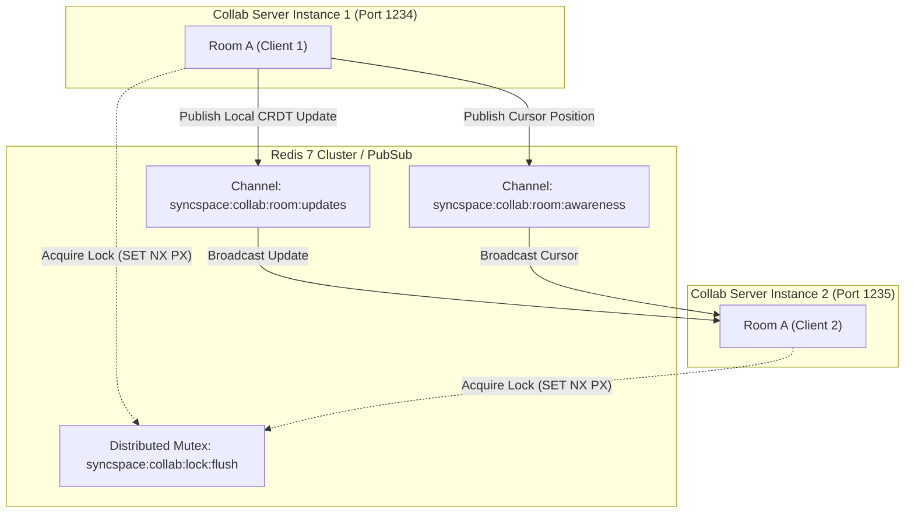
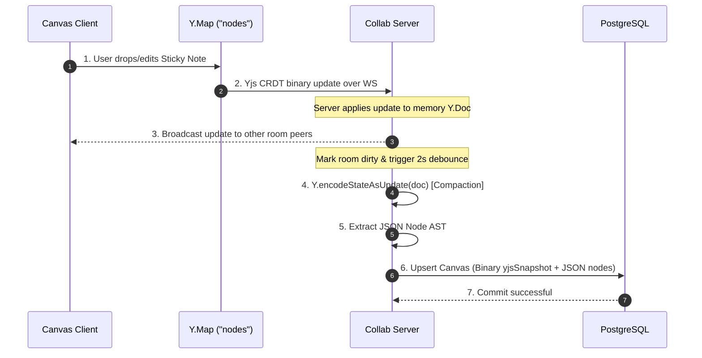

# SyncSpace — System Architecture & Engineering Specifications

This document outlines the technical architecture, data flows, collaboration protocols, and distributed scaling model of **SyncSpace** — a real-time collaborative workspace combining structured block documentation (Notion-style) with an infinite spatial whiteboard (Figma-style).

---

## 1. High-Level Architecture Overview

SyncSpace employs a decoupled, multi-tier architecture separating high-throughput real-time collaboration compute from stateless application and API logic:



---

## 2. Frontend & Backend Structure

### 2.1 Next.js 16 App Router Structure
The web tier is structured using Next.js 16 (React 19) Server Components, Suspense boundaries, and Route Handlers:

- **Public Routes**:
  - `/` — Interactive landing page showcasing the dual-engine Notion + Figma sandbox.
  - `/login`, `/register` — Authentication interfaces powered by Better Auth.
  - `/invitations/[token]` — Dedicated acceptance portal for workspace member invites.
- **Protected Application Routes (`app/(dashboard)/`)**:
  - `/dashboard` — Multi-workspace dashboard, recent documents, activity summaries.
  - `/workspaces/[workspaceId]` — Workspace view with document lists, member drawer, and activity feed.
  - `/workspaces/[workspaceId]/pages/[pageId]` — Dual-mode rich text document editor with inline comments and version history.
  - `/workspaces/[workspaceId]/canvas` — Infinite collaborative spatial whiteboard.
  - `/workspaces/[workspaceId]/settings` — Granular role management, member invitations, and workspace metadata configuration.
- **REST API Subsystem (`app/api/`)**:
  - Centralized Route Handlers enforcing authentication, RBAC authorization, and input validation.

### 2.2 Client-Side State Management
- **Document Editor**: Tiptap v3 integrated with `@tiptap/extension-collaboration` and `y-prosemirror`. Document changes mutate a shared `Y.XmlFragment` inside an in-memory `Y.Doc`.
- **Spatial Whiteboard**: Custom hook `useCanvas` (`lib/canvas/use-canvas.ts`) orchestrating a `Y.Map<CanvasNode>` synchronized over WebSocket.
- **Awareness Protocol**: Sub-50ms peer cursor positions, tool selections, and user metadata are shared via `y-websocket`'s awareness channel without persisting to the database.

---

## 3. Authentication & Authorization Flow



### 3.1 Role-Based Access Control (RBAC) Matrix
Permissions are strictly validated server-side on both HTTP REST endpoints and WebSocket binary channels:

| Action | OWNER | ADMIN | EDITOR | VIEWER |
| :--- | :---: | :---: | :---: | :---: |
| View Pages & Canvases | Yes | Yes | Yes | Yes |
| Real-time Awareness (Cursors) | Yes | Yes | Yes | Yes |
| Edit Page Content | Yes | Yes | Yes | No |
| Edit Canvas Objects | Yes | Yes | Yes | No |
| Add / Delete Comments | Yes | Yes | Yes | No |
| Create / Restore Document Versions | Yes | Yes | Yes | No |
| Create Document Pages | Yes | Yes | Yes | No |
| Invite Members (Email) | Yes | Yes | No | No |
| Remove Members / Cancel Invites | Yes | Yes | No | No |
| Change Member Roles | Yes | Yes (Except Owner) | No | No |
| Update Workspace Settings | Yes | Yes | No | No |
| Delete Workspace | Yes | No | No | No |

---

## 4. PostgreSQL & Prisma ORM Integration

Database queries leverage Prisma ORM with connection pooling via `@prisma/adapter-pg` targeting Neon PostgreSQL.

- **Connection Pooling**: Managed via `DATABASE_URL` with pooled connections for stateless Next.js handlers and persistent connections for the collaboration daemon.
- **Relational Integrity**: Foreign keys enforce cascading deletes (`onDelete: Cascade`) so workspace deletion cleanly purges member associations, pages, versions, comments, activities, and canvas nodes.
- **Indexing Strategy**: Composite B-Tree indexes on `(workspaceId, updatedAt DESC)`, `(pageId, createdAt DESC)`, and `(workspaceId, status)` optimize common query filters and prevent full-table scans.

---

## 5. Yjs & WebSocket Collaboration Architecture

SyncSpace isolates real-time CRDT processing into a standalone Node.js WebSocket service (`collaboration-server/server.ts`):



### 5.1 Protocol Flow & Message Types
The collaboration server implements the standard Yjs synchronization protocol over binary frames:
1. **Sync Step 1 (Client Handshake)**: Client sends its local `StateVector`.
2. **Sync Step 2 (Server Delta)**: Server computes missing document updates from the vector and replies with the missing CRDT diff.
3. **Sync Step 1 (Server Handshake)**: Server sends its `StateVector`; client returns missing local updates.
4. **Awareness Broadcast**: Ephemeral cursor coordinates, color tags, and user status are broadcast to all connected room peers.
5. **Write Protection**: When a client with role `VIEWER` connects, the server flags the connection as `canEdit: false`. Any incoming document update frame (Message Type 0) from that client is discarded with an error log, preserving read-only integrity.

---

## 6. Redis Distributed Coordination & Scaling

For enterprise scale and multi-server deployments, SyncSpace uses **Redis 7** (`collaboration-server/redis.ts`) to horizontally connect multiple collaboration instances:



### 6.1 Redis Key Responsibilities
1. **Pub/Sub CRDT Delta Sync**: When Client 1 on Instance 1 makes an edit, Instance 1 broadcasts the binary update chunk to `syncspace:collab:room:{roomName}:updates`. Instance 2 consumes this message and applies it to its local `Y.Doc`, forwarding the update to Client 2.
2. **Awareness Propagation**: Live cursor coordinates are published across instances via `syncspace:collab:room:{roomName}:awareness`.
3. **Inter-Server Catch-Up**: When a room is created on a new instance, it requests an initial state sync from existing instances over Redis.
4. **Distributed Persistence Mutex**: Prevents race conditions during PostgreSQL writes when multiple servers manage clients in the same room. A distributed lock with a TTL (`SET syncspace:collab:lock:{roomName} <uuid> NX PX 15000`) guarantees only one instance compacts and flushes the document to PostgreSQL at any given time.
5. **Zero-Downtime Standalone Fallback**: If Redis is not configured or fails, the collaboration server automatically reverts to standalone mode with zero downtime for local clients.

---

## 7. Canvas Synchronization & Persistence Flow

To ensure durability, instant cold starts, and searchability, SyncSpace implements a **Dual-Format Persistence Strategy**:



### 7.1 CRDT Compaction vs Tombstone Bloat
In raw CRDTs, deleting and moving objects accumulates deletion markers ("tombstones") and fragmented transaction history. SyncSpace solves this during each database flush:
- `Y.encodeStateAsUpdate(doc)` compiles the entire transaction log into a single compacted snapshot.
- Benchmarks demonstrate this reduces snapshot storage overhead by up to **80%**, ensuring fast initial sync times even after thousands of edits.

---

## 8. Deployment Architecture

SyncSpace is designed for cloud-native deployment across managed services:

```mermaid
flowchart TD
    DNS["Cloudflare DNS & DDoS Protection"]
    
    subgraph Vercel ["Vercel Edge & Serverless Platform"]
        WebEdge["Next.js Web Frontend & Route Handlers"]
    end
    
    subgraph ContainerCloud ["Container Platform (Railway / Render / Fly.io)"]
        CollabCluster["Node.js WebSocket Collaboration Server"]
    end

    subgraph DataCloud ["Managed Cloud Storage"]
        NeonDB[("Neon Serverless PostgreSQL")]
        UpstashRedis[("Upstash / Managed Redis 7")]
    end

    DNS -->|HTTPS (Port 443)| WebEdge
    DNS -->|WSS (Port 443 / SSL Terminated)| CollabCluster

    WebEdge -->|Prisma Connection Pool| NeonDB
    CollabCluster -->|Prisma Persistent Client| NeonDB
    CollabCluster <-->|TLS Pub/Sub & Lock| UpstashRedis
```

- **Frontend Hosting**: Vercel handles Next.js App Router SSR, static generation, partial prerendering, and API routes.
- **WebSocket Collab Server**: Containerized Node.js service running on a persistent host (Railway, Render, or VPS) with sticky sessions or Redis-backed multi-server distribution.
- **Database**: Neon Serverless PostgreSQL with autoscaling and instant branching.
- **Coordination**: Upstash Redis or managed Redis cluster for low-latency Pub/Sub delta distribution.

