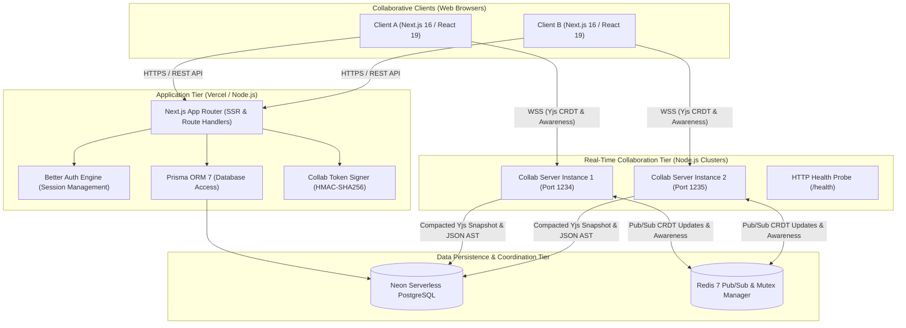
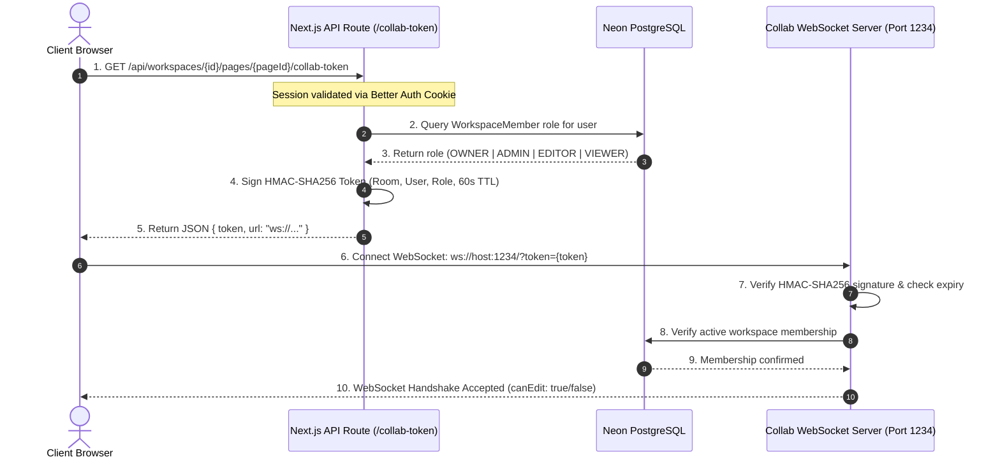
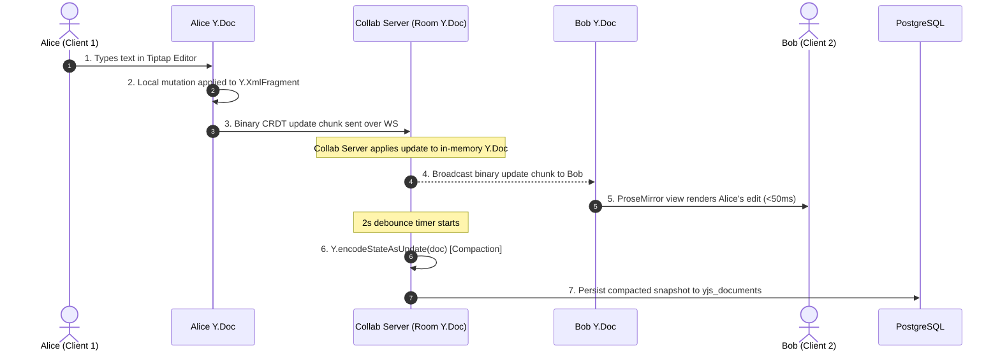
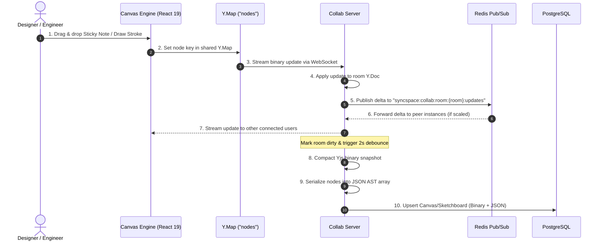
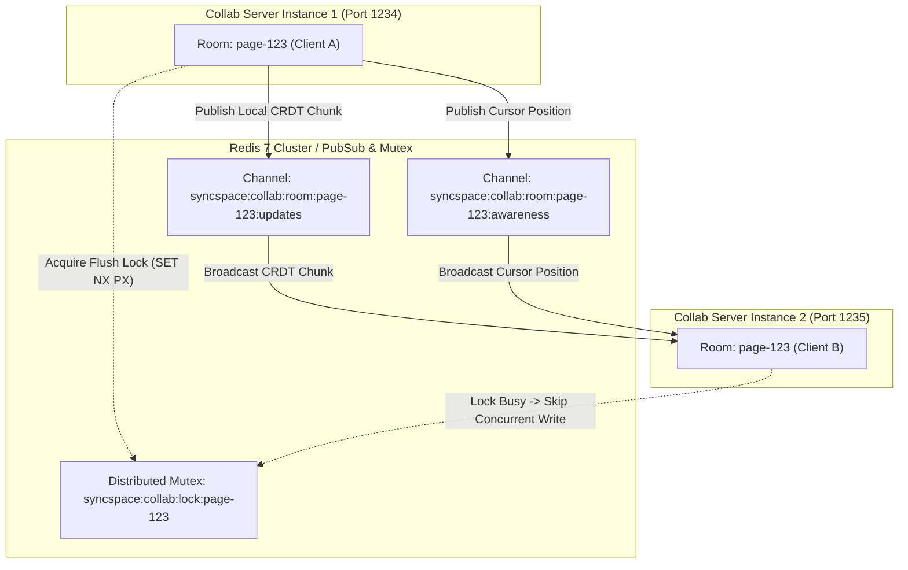
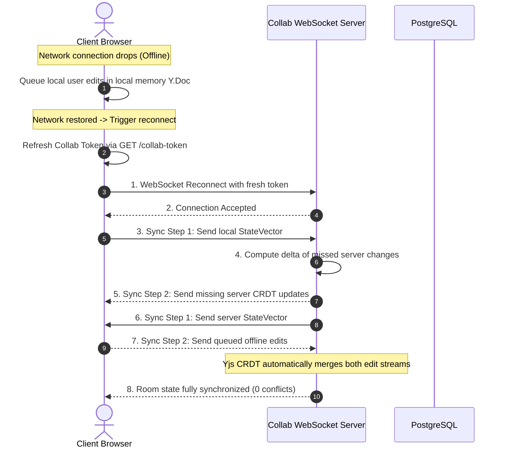

# SyncSpace — System Architecture & Engineering Specifications

This document provides a comprehensive technical breakdown of **SyncSpace**, a distributed, real-time collaborative workspace that integrates structured block document authoring (Notion-style), an infinite spatial whiteboard (Figma-style), and a freehand vector sketchboard into a single unified platform.

---

## 1. High-Level System Architecture

SyncSpace employs a decoupled, multi-tier architecture separating high-throughput real-time collaboration compute from stateless application and API logic:



---

## 2. Core Architectural Components

### 2.1 User / Browser Client
- **Framework**: Next.js 16 (App Router) with React 19 concurrent features and Server Components.
- **Document Editor**: Tiptap v3 built on ProseMirror, coupled with `@tiptap/extension-collaboration` and `y-prosemirror`. Document changes mutate a shared `Y.XmlFragment` inside an in-memory `Y.Doc`.
- **Spatial Canvas**: Custom high-performance canvas engine (`lib/canvas/use-canvas.ts`) orchestrating a shared `Y.Map<CanvasNode>`. Supports shapes, sticky notes, orthogonal connectors, and cards with pan/zoom viewport transforms.
- **Sketchboard**: Vector drawing engine (`lib/sketchboard/use-sketchboard.ts`) supporting freehand pressure-sensitive strokes, smooth quadratic Bézier curve interpolation, sticky notes, and wireframing tools over a shared `Y.Map<SketchElement>`.
- **Real-Time Presence**: Cursor coordinates, user avatars, active selection IDs, and assigned colors stream via the `y-protocols/awareness` protocol over WebSockets with sub-50ms latency.

### 2.2 Next.js Web & API Tier
- **Routing**: Next.js App Router with React Server Components (RSC) for zero-bundle initial page loads and fast server-side rendering.
- **REST API Routes (`app/api/`)**: Centralized route handlers handling workspace CRUD, member management, invitation tokens, comments, version snapshots, and room token issuance.
- **Authentication**: Managed via **Better Auth** with HTTP-only secure cookie sessions, password hashing, and user account verification.
- **Collaboration Token Signer**: Issues cryptographically signed HMAC-SHA256 tokens (`src/lib/collaboration/tokens.ts`) with a short 60-second time-to-live (TTL). Every client must present a valid token to connect to the WebSocket collaboration daemon.

### 2.3 Standalone Collaboration WebSocket Server
- **Service**: Standalone Node.js process (`collaboration-server/server.ts`) listening on port 1234.
- **Protocol**: Duplex WebSockets implementing the Yjs binary sync protocol (Sync Steps 1 & 2) and Awareness protocol.
- **Role Enforcement**: Parses signed connection tokens, performs database role verification (`OWNER`, `ADMIN`, `EDITOR`, `VIEWER`), and enforces write protection. Connections from `VIEWER` clients have incoming CRDT edit frames dropped at the socket layer.
- **Persistence Daemon**: In-memory rooms are debounced (2-second quiet period) and flushed to PostgreSQL through `collaboration-server/persistence.ts`.
- **Health & Monitoring**: Exposes an Express HTTP endpoint at `GET /health` reporting memory usage, uptime, active rooms, dirty room count, and Redis connection status.

### 2.4 Persistence & Distributed Coordination Tier
- **PostgreSQL Database**: Neon serverless PostgreSQL managed via Prisma ORM 7 (`@prisma/adapter-pg`). Houses user accounts, workspaces, permissions, comments, revision history, and canvas states.
- **Dual-Format Storage**: Canvas and Sketchboard models store both a raw binary `yjsSnapshot` (for zero-loss CRDT rehydration) and a structured JSON AST (for fast SSR, search, and REST reads without spinning up a Yjs runtime).
- **Redis 7 Coordination**: When multiple collaboration server instances are deployed, Redis Pub/Sub synchronizes CRDT deltas and peer awareness across instances, while Redis distributed locks (`SET NX PX`) prevent concurrent database flush race conditions.

---

## 3. Communication & Data Flows

### 3.1 Authentication & Token Issuance Flow

Before a client can open a WebSocket connection to collaborate on a document, canvas, or sketchboard, it must exchange its web session cookie for a short-lived signed room token:



---

### 3.2 Document Editing & CRDT Synchronization Flow

Document changes are modeled as Conflict-Free Replicated Data Types (CRDTs) to ensure eventual consistency without central locking:



---

### 3.3 Canvas & Sketchboard Synchronization Flow

The Spatial Canvas and Sketchboard engines synchronize spatial objects (`nodes` and `elements`) using a `Y.Map` collection:



---

### 3.4 Multi-Server Redis Coordination Architecture

When scaling horizontally across multiple container instances, Redis 7 acts as the inter-process message bus and concurrency manager:



#### Redis Distributed Mutex
When multiple servers host clients in the same room, debounced persistence flushes could race against each other. SyncSpace eliminates database write contention using Redis distributed mutex locks:
```typescript
const lockAcquired = await redis.set(
  `syncspace:collab:lock:${roomName}`,
  instanceId,
  "PX",
  15000,
  "NX"
);
if (lockAcquired) {
  await flushToPostgres(roomName, ydoc);
}
```
If the lock is currently held by another instance, the second instance defers its flush, ensuring safe, single-writer consistency.

---

### 3.5 Reconnection and Recovery Flow

When a client loses network connectivity (e.g., WiFi drop or laptop sleep), SyncSpace handles recovery automatically without data loss:



---

## 4. Architectural Guarantees & Constraints

1. **Eventual Consistency**: By leveraging Yjs CRDTs, concurrent edits to the same document block or canvas node converge deterministically across all peers regardless of message arrival order.
2. **Zero Context Switching**: Documents, flowcharts, and sticky wireframes share the same workspace security boundary, allowing engineers and designers to reference specs alongside visual diagrams.
3. **Compacted Snapshot Storage**: CRDT tombstones (deleted items) are compacted into a unified snapshot upon each database flush, reducing snapshot sizes by up to 80% compared to raw transactional logs.
4. **Resilient Degradation**: If Redis becomes unavailable, the collaboration server automatically degrades to standalone in-memory routing, keeping connected clients online without throwing unhandled exceptions.
