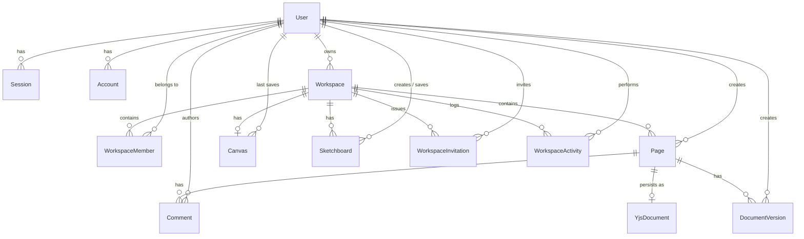

# SyncSpace — Database Architecture & Data Models

This document provides complete documentation for the PostgreSQL database schema, Prisma 7 models, entity relationships, constraints, indexing strategies, and data persistence mechanics in **SyncSpace**.

---

## 1. Entity-Relationship Overview

The SyncSpace database is organized into modular relational domains: Authentication & Identity (Better Auth), Workspaces & RBAC Governance, Document Editor & CRDT Storage, Spatial Canvas & Sketchboard, and Audit Activities.



---

## 2. Prisma Enums

### 2.1 `WorkspaceRole`
Defines the role-based access control (RBAC) hierarchy for workspace members:
```prisma
enum WorkspaceRole {
  OWNER    // Creator or transferred owner; full administrative control including deletion
  ADMIN    // Can manage settings, invite and remove members (cannot remove OWNER)
  EDITOR   // Full read/write access to pages, canvas, sketchboards, comments, and versions
  MEMBER   // Standard legacy member (equivalent to EDITOR permissions)
  VIEWER   // Read-only access to pages, canvas, sketchboard, and activity; cannot mutate state
}
```

### 2.2 `InvitationStatus`
Tracks the lifecycle of email-based workspace invitations:
```prisma
enum InvitationStatus {
  PENDING    // Invite issued and awaiting recipient action
  ACCEPTED   // Recipient authenticated and accepted membership
  REJECTED   // Recipient explicitly declined the invite
  EXPIRED    // Invite reached expiration timestamp (7-day TTL)
  CANCELLED  // Admin or Owner revoked the invitation before acceptance
}
```

---

## 3. Data Models & Tables

### 3.1 Authentication & User Management (Better Auth)

#### Table: `users`
Represents an authenticated user identity in the system.
| Field | Type | Attributes | Description |
| :--- | :--- | :--- | :--- |
| `id` | `String` | `@id @default(cuid())` | Unique identifier (CUID) |
| `name` | `String` | | Full display name |
| `email` | `String` | `@unique` | Unique email address |
| `emailVerified` | `Boolean` | `@default(false)` | Email verification flag |
| `image` | `String?` | | Profile avatar URL |
| `passwordHash` | `String?` | | Password hash (Argon2 / Scrypt) |
| `createdAt` | `DateTime` | `@default(now())` | Account creation timestamp |
| `updatedAt` | `DateTime` | `@updatedAt` | Last profile update timestamp |

#### Table: `sessions`
Active browser authentication sessions managed by Better Auth.
| Field | Type | Attributes | Description |
| :--- | :--- | :--- | :--- |
| `id` | `String` | `@id @default(cuid())` | Unique session record ID |
| `token` | `String` | `@unique` | Session token stored in HTTP-only cookie |
| `userId` | `String` | `FK -> users.id` | Associated user identity (`onDelete: Cascade`) |
| `expiresAt` | `DateTime` | | Session expiration timestamp |
| `ipAddress` | `String?` | | Client IP address at login |
| `userAgent` | `String?` | | Client browser user agent string |
| `createdAt` | `DateTime` | `@default(now())` | Session creation timestamp |
| `updatedAt` | `DateTime` | `@updatedAt` | Last activity update timestamp |

*Indexes*: `@@index([userId])`

#### Table: `accounts`
Third-party OAuth identity links and credential entries.
| Field | Type | Attributes | Description |
| :--- | :--- | :--- | :--- |
| `id` | `String` | `@id @default(cuid())` | Unique account link ID |
| `accountId` | `String` | | Provider-specific account ID |
| `providerId` | `String` | | Auth provider (e.g., `credentials`, `github`) |
| `userId` | `String` | `FK -> users.id` | Associated user identity (`onDelete: Cascade`) |
| `accessToken` | `String?` | | OAuth access token |
| `refreshToken`| `String?` | | OAuth refresh token |
| `password` | `String?` | | Hashed password if provider is credentials |

*Indexes*: `@@index([userId])`

#### Table: `verifications`
One-time email verification and password reset tokens.
*Indexes*: `@@index([identifier])`

---

### 3.2 Workspace & Membership Subsystem

#### Table: `workspaces`
Organizational boundary for projects, documents, canvases, sketchboards, and teams.
| Field | Type | Attributes | Description |
| :--- | :--- | :--- | :--- |
| `id` | `String` | `@id @default(cuid())` | Unique workspace ID (CUID) |
| `name` | `String` | | Workspace display name |
| `description` | `String?` | `@db.Text` | Optional workspace description |
| `icon` | `String?` | | Emoji or icon identifier |
| `ownerId` | `String` | `FK -> users.id` | Workspace owner (`onDelete: Cascade`) |
| `createdAt` | `DateTime` | `@default(now())` | Workspace creation timestamp |
| `updatedAt` | `DateTime` | `@updatedAt` | Last modification timestamp |

*Indexes*: `@@index([ownerId])`

#### Table: `workspace_members`
Association table connecting users to workspaces with assigned RBAC roles.
| Field | Type | Attributes | Description |
| :--- | :--- | :--- | :--- |
| `id` | `String` | `@id @default(cuid())` | Unique membership ID |
| `userId` | `String` | `FK -> users.id` | Member user ID (`onDelete: Cascade`) |
| `workspaceId` | `String` | `FK -> workspaces.id` | Target workspace ID (`onDelete: Cascade`) |
| `role` | `WorkspaceRole` | `@default(MEMBER)` | Assigned RBAC role |
| `createdAt` | `DateTime` | `@default(now())` | Timestamp member joined |

*Constraints & Indexes*:
- `@@unique([workspaceId, userId])` — Guarantees a user cannot have duplicate memberships in the same workspace.
- `@@index([userId])` — Fast lookup of all workspaces for a user.
- `@@index([workspaceId])` — Fast lookup of all members in a workspace.
- `@@index([workspaceId, createdAt])` — Chronological member sorting.

---

### 3.3 Document Editor & Collaborative Subsystem

#### Table: `pages`
Notion-style block documents within a workspace.
| Field | Type | Attributes | Description |
| :--- | :--- | :--- | :--- |
| `id` | `String` | `@id @default(cuid())` | Unique page ID |
| `title` | `String` | `@default("Untitled")` | Document title |
| `content` | `String?` | `@db.Text` | ProseMirror JSON document string |
| `workspaceId` | `String` | `FK -> workspaces.id` | Enclosing workspace (`onDelete: Cascade`) |
| `createdById` | `String` | `FK -> users.id` | Document creator (`onDelete: Cascade`) |
| `createdAt` | `DateTime` | `@default(now())` | Creation timestamp |
| `updatedAt` | `DateTime` | `@updatedAt` | Last modified timestamp |

*Indexes*:
- `@@index([workspaceId])`
- `@@index([createdById])`
- `@@index([workspaceId, updatedAt(sort: Desc)])` — Optimized for recent document feeds.

#### Table: `yjs_documents`
Durable binary Yjs CRDT snapshots for real-time document collaboration.
| Field | Type | Attributes | Description |
| :--- | :--- | :--- | :--- |
| `id` | `String` | `@id @default(cuid())` | Unique record ID |
| `pageId` | `String` | `@unique, FK -> pages.id` | 1-to-1 association with page (`onDelete: Cascade`) |
| `snapshot` | `Bytes` | | Compacted binary Yjs state update |
| `createdAt` | `DateTime` | `@default(now())` | Initial creation timestamp |
| `updatedAt` | `DateTime` | `@updatedAt` | Last snapshot compaction flush |

*Indexes*: `@@index([pageId])`

#### Table: `comments`
Discussion threads attached to document pages.
| Field | Type | Attributes | Description |
| :--- | :--- | :--- | :--- |
| `id` | `String` | `@id @default(cuid())` | Unique comment ID |
| `content` | `String` | `@db.Text` | Comment body text |
| `pageId` | `String` | `FK -> pages.id` | Target document page (`onDelete: Cascade`) |
| `authorId` | `String` | `FK -> users.id` | Comment author (`onDelete: Cascade`) |
| `createdAt` | `DateTime` | `@default(now())` | Timestamp posted |
| `updatedAt` | `DateTime` | `@updatedAt` | Last edit timestamp |

*Indexes*:
- `@@index([pageId])`
- `@@index([authorId])`
- `@@index([pageId, createdAt(sort: Asc)])` — Chronological comment thread ordering.

#### Table: `document_versions`
Immutable document snapshots for version history and point-in-time recovery.
| Field | Type | Attributes | Description |
| :--- | :--- | :--- | :--- |
| `id` | `String` | `@id @default(cuid())` | Unique revision ID |
| `pageId` | `String` | `FK -> pages.id` | Associated document page (`onDelete: Cascade`) |
| `content` | `String` | `@db.Text` | Frozen ProseMirror JSON snapshot |
| `createdById` | `String` | `FK -> users.id` | User who created the version (`onDelete: Cascade`) |
| `createdAt` | `DateTime` | `@default(now())` | Snapshot timestamp |

*Indexes*:
- `@@index([pageId])`
- `@@index([createdById])`
- `@@index([pageId, createdAt(sort: Desc)])` — Reverse-chronological revision history.

---

### 3.4 Spatial Canvas & Sketchboard Subsystem

#### Table: `canvases`
Infinite spatial whiteboard associated with a workspace.
| Field | Type | Attributes | Description |
| :--- | :--- | :--- | :--- |
| `id` | `String` | `@id @default(cuid())` | Unique canvas ID |
| `workspaceId` | `String` | `@unique, FK -> workspaces.id` | 1-to-1 association with workspace (`onDelete: Cascade`) |
| `name` | `String` | `@default("Spatial Canvas")`| Whiteboard title |
| `description` | `String?` | `@db.Text` | Optional description |
| `nodes` | `Json` | `@default("[]")` | Extracted JSON AST array of canvas nodes |
| `viewport` | `Json?` | | Viewport coordinates `{x, y, zoom}` |
| `yjsSnapshot` | `Bytes?` | | Compacted binary Yjs CRDT state vector |
| `version` | `Int` | `@default(1)` | Monotonic persistence revision counter |
| `lastSavedById`| `String?`| `FK -> users.id` | Last editor (`onDelete: SetNull`) |
| `createdAt` | `DateTime` | `@default(now())` | Canvas creation timestamp |
| `updatedAt` | `DateTime` | `@updatedAt` | Last state flush timestamp |

*Indexes*: `@@index([workspaceId])`

#### Table: `sketchboards`
Freehand drawing and vector sketchboard boards within a workspace.
| Field | Type | Attributes | Description |
| :--- | :--- | :--- | :--- |
| `id` | `String` | `@id @default(cuid())` | Unique sketchboard ID |
| `workspaceId` | `String` | `FK -> workspaces.id` | Parent workspace (`onDelete: Cascade`) |
| `name` | `String` | `@default("Workspace Sketchboard")` | Sketchboard title |
| `description` | `String?` | `@db.Text` | Optional description |
| `elements` | `Json` | `@default("[]")` | Extracted JSON array of vector elements & strokes |
| `viewport` | `Json?` | | Viewport state `{panX, panY, zoom}` |
| `gridMode` | `String` | `@default("dots")` | Background grid mode (`dots`, `lines`, `none`) |
| `canvasBg` | `String` | `@default("white")` | Background canvas tint (`white`, `warm`, `dark`) |
| `yjsSnapshot` | `Bytes?` | | Compacted binary Yjs CRDT state update |
| `version` | `Int` | `@default(1)` | Revision counter |
| `createdById` | `String?` | `FK -> users.id` | Creator (`onDelete: SetNull`) |
| `lastSavedById`| `String?`| `FK -> users.id` | Last editor (`onDelete: SetNull`) |
| `createdAt` | `DateTime` | `@default(now())` | Board creation timestamp |
| `updatedAt` | `DateTime` | `@updatedAt` | Last modification timestamp |

*Indexes*:
- `@@index([workspaceId])`
- `@@index([createdById])`
- `@@index([workspaceId, updatedAt(sort: Desc)])` — Sorting boards by recent activity.

---

### 3.5 Governance, Invitations & Audit Subsystem

#### Table: `workspace_invitations`
Email invitation tokens for onboarding team members with predefined roles.
| Field | Type | Attributes | Description |
| :--- | :--- | :--- | :--- |
| `id` | `String` | `@id @default(cuid())` | Unique invitation record ID |
| `workspaceId` | `String` | `FK -> workspaces.id` | Target workspace (`onDelete: Cascade`) |
| `email` | `String` | | Invitee email address |
| `role` | `WorkspaceRole` | `@default(MEMBER)` | Role granted upon acceptance |
| `token` | `String` | `@unique @default(cuid())` | Cryptographically random acceptance token |
| `status` | `InvitationStatus`| `@default(PENDING)` | Current status |
| `inviterId` | `String` | `FK -> users.id` | User issuing the invitation (`onDelete: Cascade`) |
| `expiresAt` | `DateTime` | | Expiration timestamp (7-day TTL) |
| `createdAt` | `DateTime` | `@default(now())` | Issue timestamp |
| `updatedAt` | `DateTime` | `@updatedAt` | Last status update timestamp |

*Indexes*:
- `@@index([workspaceId])`
- `@@index([email])`
- `@@index([token])`
- `@@index([workspaceId, status])` — Active pending invite filtering.

#### Table: `workspace_activities`
Auditable event log tracking all workspace actions.
| Field | Type | Attributes | Description |
| :--- | :--- | :--- | :--- |
| `id` | `String` | `@id @default(cuid())` | Unique activity record ID |
| `workspaceId` | `String` | `FK -> workspaces.id` | Target workspace (`onDelete: Cascade`) |
| `actorId` | `String` | `FK -> users.id` | User who performed the action (`onDelete: Cascade`) |
| `action` | `String` | | Event verb (e.g. `PAGE_CREATED`, `MEMBER_INVITED`) |
| `entityType` | `String` | | Target entity type (`PAGE`, `CANVAS`, `MEMBER`) |
| `entityId` | `String?` | | Identifier of affected entity |
| `metadata` | `Json?` | | Context payload (e.g., title changes, roles) |
| `createdAt` | `DateTime` | `@default(now())` | Timestamp of event |

*Indexes*:
- `@@index([workspaceId])`
- `@@index([actorId])`
- `@@index([createdAt])`
- `@@index([workspaceId, createdAt(sort: Desc)])` — Reverse-chronological activity stream.

---

## 4. Dual Persistence Strategy

SyncSpace avoids common pitfalls of pure-CRDT databases by storing data in two parallel formats:

1. **Compacted Binary CRDT Snapshot (`yjsSnapshot` / `Bytes`)**:
   - Encoded via `Y.encodeStateAsUpdate(doc)`.
   - Preserves complete CRDT causality, peer vector clocks, and structural metadata.
   - Used when the WebSocket collaboration server boots up a room or rehydrates state after idle termination.
2. **Normalized JSON AST (`nodes`, `elements`, `content`)**:
   - Serialized array of JavaScript objects.
   - Allows Next.js Server Components to render initial HTML without loading WebAssembly or initializing Yjs runtimes on the web server.
   - Enables standard PostgreSQL JSON querying, indexing, full-text search, and REST API access.
